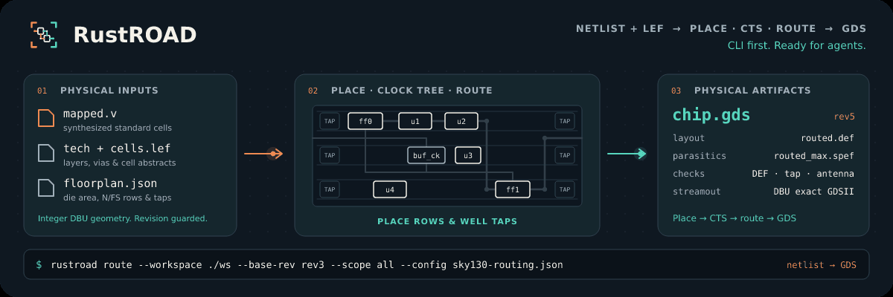

<p align="center">
  
</p>

<h1 align="center">Physical design for the next design iteration.</h1>

<p align="center">
  <a href="https://lab-emi.github.io/RustEDA/modules/rustroad/">Documentation</a> ·
  <a href="https://github.com/lab-emi/RustEDA">RustEDA</a> ·
  <a href="https://lab-emi.github.io/RustEDA/benchmarks/">Benchmarks</a> ·
  <a href="LICENSE">Apache-2.0</a>
</p>

<picture>
  <source media="(prefers-reduced-motion: reduce)" srcset="docs/assets/rustroad-banner.svg">
  
</picture>

RustROAD implements placement, clock trees, routing, extraction and GDS export. The recorded small-block baseline spans SKY130 HD and GF180 7T: **15 ordinary passes and one declared deviation**. OpenC910 physical implementation remains unverified.

Part of **[RustEDA](https://github.com/lab-emi/RustEDA)**, infrastructure for chip-design recursive self-improvement. Native tools shorten the work between inference steps; verified results guide the next iteration.

[Current qualification and limits](docs/closeout-2026-10-25.md) · [Flow guide](docs/rtl2gds.md)

## RustROAD vs OpenROAD at a glance

Ibex RTL-to-GDS on IHP SG13G2 with EZ130 cells and two SRAM macros, 2026-11-13: RustEDA and LibreLane 3.0.17 (OpenROAD, Yosys, KLayout, Magic, Netgen) ran one after the other on the same 4-vCPU host from the same prepared inputs, and the same signoff scripts checked both layouts. Every RustEDA engine was built with Rust 1.100.0, and RustEDA's step graph ran under its Rust executor, `rusteda flow exec`.

- **Routing 7.8× faster than OpenROAD** (266.71 s against 2,083.40 s, global and detailed), **placement and clock tree 2.1× faster** (19.56 s against 41.21 s), and **export 159× faster** than LibreLane's streamout steps (1.67 s against 266.29 s).
- **5.2 % less standard-cell area, 7.7 % less routed wire and 1.3 % fewer vias**, with 52 antenna diodes against 504 and **zero timing violations** against LibreLane's 112.
- GDS export **2.8× faster than KLayout** with **2.0× less peak memory**. **RustROAD's own extraction is slower than OpenRCX**: 1.22× its time at 4 threads (4.664 s against 3.829 s; the ranges do not overlap) and 2.19× at 2 threads, with 1.60× its peak memory.
- Foundry DRC, antenna DRC, LVS and the latch-up check run **1.4×, 1.3×, 1.5× and 1.3× faster** on RustROAD's layout (same scripts, same load), and OpenRCX now extracts its DEF in the time it takes on LibreLane's (1.00×, level). The whole RustEDA flow finishes **4.4× sooner end to end** (751.54 s against 3,283.05 s).

LibreLane's layout fails the shared timing gate (112 maximum-capacitance and fanout violations at TT and SS) and its equivalence check does not complete, so the receipt keeps its own ratio fields null under its publication rule; the multiples here divide the recorded times. Stages are paired by phase, not as identical tasks. Against the three losses of 2026-11-05, in same-load runs: repair before global routing now takes 0.73× the time of LibreLane's two pre-route resizer steps (ranges do not overlap; 1.18× on 2026-11-05), OpenRCX on RustROAD's layout is level with its time on LibreLane's (1.00×, ranges overlap; 1.36× on 2026-11-05) and the latch-up check on RustROAD's layout takes 0.76× its time on LibreLane's (1.11× with the checker of that campaign). RustEDA is still not faster or not better everywhere: RustROAD's standalone extraction takes 1.22× OpenRCX's time at 4 threads (2.19× at 2), RustSTA's peak memory at 4 threads is 11.8 % above OpenSTA's, the timing gate is level (0.98×, ranges overlap) and RustROAD's layout keeps less hold margin (TT 0.108 ns against 0.172 ns; both meet hold). [All stages, gates and losses](https://lab-emi.github.io/RustEDA/benchmarks/#ibex-host-campaign-2026-11-13)

## Latest development · 2026-11-13

The RustEDA Ibex host campaign of 2026-11-13 (IHP SG13G2 / EZ130 with two real
SRAMs, on a 4-vCPU Intel Xeon cloud host reporting 2.10 GHz, with 15.7 GiB RAM
and no swap; a different virtual machine from 2026-11-05's) ran RustROAD CLI
0.5.0 (commit [`f90f2dd`](https://github.com/lab-emi/RustROAD/commit/f90f2dd805cbad1ba03dcc4fb84c2d36dfb4d5f7),
built with Rust 1.100.0) in the repository's current native recipe
(superproject `820ffc8`) under an 8 GiB memory cap (+2 GiB memsw), with the
step graph run by the Rust executor `rusteda flow exec`, and OpenROAD 26Q3 in
LibreLane 3.0.17 Classic under a 10 GiB cap, from the same prepared RTL, SDC
and floorplan. The same independent scripts checked both final layouts.
**Both pass foundry main and antenna DRC with 0 violations, latch-up tap
coverage and full-device LVS; on the shared timing gate the native layout has
zero setup, hold, slew, capacitance and fanout violations at TT and SS, while
LibreLane's keeps 28 (TT) and 24 (SS) capacitance and 30 fanout violations.**
The native layout has less standard-cell area, less routed wire and fewer
vias, from a different netlist; the receipt keeps its ratio fields null
because LibreLane's layout fails a gate; divided, the native layout has
5.2 % less area, 7.7 % less wire and 1.3 % fewer vias.

What changed in RustROAD since 2026-11-05: the router's topology controls
(RustROAD [`d010664`](https://github.com/lab-emi/RustROAD/commit/d0106647b548a83917c91391a8a105bb78ea238b),
superproject `3cd3061`) price wrong-way wire higher (`wrong_way_factor` 6
instead of 3) with a bend surcharge (`bend_cost` 100), run a stronger
two-pass via reduction, rewrite walled-in same-layer chains jointly with the
nets that wall them in, move the turn at an escape top to the escape's via,
and declare the router's track grid in the DEF (`TRACKS` statements). The
placement and cells are 2026-11-05's; the route changed. The routed DEF went
from about 192 thousand wire pieces to 160 thousand, at the cost of 2,060
more vias (120,585 against 118,525), with 895,279.2 µm of wire against
897,357.3 µm. In that change's interleaved A/B, the shared OpenRCX gate on
the native layout went from 1.33× to 0.99× its time on LibreLane's
([routing budget](docs/routing-budget.md#wire-pieces-against-vias-prices-joint-moves-escape-jogs-track-grid)).
The four Python backend helpers of the recipe (physical inputs, antenna
session, its review, post-route repair) became `rustroad` commands
([native flow steps](docs/flow-steps.md)).

| Ibex final layout | RustROAD, native recipe | OpenROAD 26Q3, LibreLane Classic |
| --- | --- | --- |
| Standard-cell area | 187,585.2 µm² | 197,913.7 µm² |
| Routed signal wirelength | 895,279.2 µm | 969,571.6 µm |
| Vias | 120,585 | 122,194 |
| Standard cells / antenna diodes / taps / fillers | 14,058 / 52 / 5,934 / 34,322 | 15,191 / 504 / 6,900 / 44,672 |
| Foundry main / antenna DRC violations | 0 / 0 | 0 / 0 |
| Latch-up tap coverage (LU.a, LU.b) and full-device LVS | `passed`, `passed` | `passed`, `passed` |
| Slew / capacitance / fanout violations, TT and SS | 0 / 0 / 0 | 0 / 28 / 30 TT, 0 / 24 / 30 SS |
| Hold worst slack, TT / SS | 0.108 / 0.206 ns | 0.172 / 0.312 ns |
| Placement and CTS | 19.56 s | 17.88 s placement + 23.33 s CTS |
| Routing | 266.71 s at 4 threads, global and detailed | 75.68 s global routing and antenna checks/repair + 2,007.72 s detailed (4 threads) |
| Repair after routing | 4.74 s post-route + 8.93 s antenna repair and verification | None; its post-GRT repair runs before detailed routing |

Stage times come from one timed run of each flow; the netlists and the repair
around each stage differ, so the quotients in the summary above pair stages by
phase, not as identical tasks. The producer completed all
114 steps, and GDS, DEF, netlists and native SPEF were byte-identical in a
second producer run through `be_timing`. Both layouts meet hold; the native
one keeps less hold margin.

On the same final layout, RustROAD's GDS export is faster than KLayout
0.30.12's DEF-to-GDS streamout (0.498 s against 1.375 s, 2.76×, with
104,212 KiB against 204,424 KiB peak RSS; timing only: the two GDS files are
not byte-equivalent). **Its extraction is slower than OpenRCX**: 4.664 s
against 3.829 s at the recipe's 4 threads (1.22×; the ranges do not overlap)
and 7.951 s against 3.625 s at 2 threads (2.19×), with about 3.7 times
OpenRCX's CPU time (13.78–14.04 s against 3.60–3.89 s per run at 4 threads)
and 1.60× its peak RSS (324,408 against 203,308 KiB). Its total capacitance
is 6.0 % above OpenRCX's and its total resistance 0.5 % below. Medians are of
three measured repetitions after one warm-up, interleaved.

As history, not a before/after: 2026-11-05 ran on another host, and with the
same configuration and byte-identical DEF and netlists every LibreLane stage
took less time on this one (its flow 0.81× its 2026-11-05 time). On
2026-11-05 RustROAD's routing took 302.24 s and placement and CTS 28.00 s,
and its extraction was level with OpenRCX at 4 threads (6.260 s against
5.944 s, 1.05×, overlapping ranges); since then OpenRCX's median on this
head-to-head fell from 5.944 s to 3.829 s (0.64×) and RustROAD's from
6.260 s to 4.664 s (0.75×), on the changed layout. GDS export took 0.831 s
against KLayout's 1.938 s then.

In interleaved same-load runs of the shared gates after the campaign (on
another 4-vCPU VM, reporting 2.30 GHz, after a container restart; both
layouts alike), foundry main DRC, antenna DRC, LVS and latch-up tap coverage
are faster on the native layout (0.73×, 0.75×, 0.69× and 0.76× of the time on
LibreLane's; the ranges do not overlap), and OpenRCX extraction (median
3.37 s against 3.38 s, 1.00×) and RustSTA + OpenSTA timing (0.98×) are level,
with overlapping ranges. In the flow, `be_openrcx` took 4.23 s on the native
DEF against 4.541 s for LibreLane's RCX step (6.79 s against 5.557 s on
2026-11-05).

[Place, CTS and route vs OpenROAD](https://lab-emi.github.io/RustEDA/benchmarks/#rustroad-place-cts-and-route-vs-openroad-2026-11-13) ·
[Extraction vs OpenRCX](https://lab-emi.github.io/RustEDA/benchmarks/#rustroad-extraction-vs-openrcx-2026-11-13) ·
[GDS export vs KLayout](https://lab-emi.github.io/RustEDA/benchmarks/#rustroad-gds-export-vs-klayout-2026-11-13) ·
[Shared gates](https://lab-emi.github.io/RustEDA/benchmarks/#shared-gates-2026-11-13) ·
[Host campaign 2026-11-13](https://lab-emi.github.io/RustEDA/benchmarks/#ibex-host-campaign-2026-11-13) ·
[Scope and tables](docs/development-status.md#ibex-host-campaign-2026-11-13)

## Ibex host campaign · 2026-11-05

The RustEDA Ibex host campaign of 2026-11-05 (IHP SG13G2 / EZ130 with two real
SRAMs, on a 4-vCPU Intel Xeon cloud host with 15.7 GiB RAM and no swap; a
different and slower machine than on 2026-11-02) ran RustROAD CLI 0.5.0
(commit [`1921481`](https://github.com/lab-emi/RustROAD/commit/1921481c5f0fde21b62971a3a21e245065c9bf90)) in the repository's current native recipe under an 8 GiB
memory cap (+2 GiB memsw), and OpenROAD 26Q3 in LibreLane 3.0.17 Classic under
a 10 GiB cap, from the same prepared RTL, SDC and floorplan. The same
independent scripts checked both final layouts. **Both pass foundry main and
antenna DRC with 0 violations, latch-up tap coverage and full-device LVS; on
the shared timing gate the native layout has zero setup, hold, slew,
capacitance and fanout violations at TT and SS, while LibreLane's keeps 28 (TT)
and 24 (SS) capacitance and 30 fanout violations.** The native layout has less
standard-cell area, less routed wire and fewer vias, from a different netlist;
the receipt keeps its ratio fields null because LibreLane's layout fails a gate;
divided, the native layout has 5.2 % less area, 7.4 % less wire and 3.0 % fewer vias.

| Ibex final layout | RustROAD, native recipe | OpenROAD 26Q3, LibreLane Classic |
| --- | --- | --- |
| Standard-cell area | 187,585.2 µm² | 197,913.7 µm² |
| Routed signal wirelength | 897,357.3 µm | 969,571.6 µm |
| Vias | 118,525 | 122,194 |
| Standard cells / antenna diodes / taps / fillers | 14,058 / 52 / 5,934 / 34,322 | 15,191 / 504 / 6,900 / 44,672 |
| Foundry main / antenna DRC violations | 0 / 0 | 0 / 0 |
| Latch-up tap coverage (LU.a, LU.b) and full-device LVS | `passed`, `passed` | `passed`, `passed` |
| Slew / capacitance / fanout violations, TT and SS | 0 / 0 / 0 | 0 / 28 / 30 TT, 0 / 24 / 30 SS |
| Placement and CTS | 28.00 s | 19.69 s placement + 27.36 s CTS |
| Routing | 302.24 s at 4 threads, global and detailed | 83.34 s global routing and antenna checks/repair + 2,486.85 s detailed (4 threads) |
| Repair after routing | 7.34 s post-route + 18.99 s antenna repair and verification | None; its post-GRT repair runs before detailed routing |

Stage times come from one timed run of each flow; the netlists and the repair
around each stage differ, so the quotients in the summary above pair stages by
phase, not as identical tasks. The producer completed all
114 steps, and GDS, DEF, netlists and native SPEF were byte-identical in a
second producer run through `be_timing`.

On the same final layout, RustROAD's GDS export is faster than KLayout's
LEF/DEF streamout (0.831 s against 1.938 s, timing only: the two GDS files are
not byte-equivalent), and its extraction, now at the recipe's `--threads 4`,
is level with OpenRCX at 4 threads (6.260 s against 5.944 s; the two ranges
overlap) and slower at 2 threads (10.121 s against 5.988 s, 1.69×), with about
three times OpenRCX's CPU time (17.8–19.1 s against 5.9–6.5 s per run) and
1.42–1.46× its peak RSS. Medians are of three measured repetitions after one
warm-up, interleaved.

Two shared gates are slower on the native layout, for different reasons. **OpenRCX extraction is slower on the native DEF**: in
interleaved same-load runs the shared `extraction` gate took a median 6.57 s
against 4.84 s on LibreLane's DEF (1.36×; ranges 6.35–6.74 and 4.58–5.04 s,
5 runs each), and the flow's own `be_openrcx` took 6.79 s against 5.557 s
for LibreLane's RCX step. Its time is consistent with the wire pieces it
extracts, which the route topology sets: the native DEF has 192,328 pieces against 129,901
(`scripts/def_pieces.py`), with 42,789 staircase and 39,398 zigzag pieces
against 25,925 and 17,576, although it has less wire and fewer vias. The
latch-up tap-coverage gate was slower on the native layout in the campaign (median 50.54 s against 45.47 s, 1.11×),
because the checker's time followed the notched n-well domains of the flip-flop masters that synthesis chose;
with the shared checker of 2026-11-12, changed for both layouts, which certifies the same boxes and adds an
in-well LU.a path, it is faster on the native layout: median 5.70 s against 7.34 s (0.78×, ranges 5.51–6.04
and 7.05–7.61 s, 6 interleaved runs each; [tap integration](docs/tap-integration.md)). Foundry main DRC, antenna DRC and
LVS are faster on the native layout (benchmark page).

[Place, CTS and route vs OpenROAD](https://lab-emi.github.io/RustEDA/benchmarks/#rustroad-place-cts-and-route-vs-openroad-2026-11-05) ·
[Host campaign 2026-11-05](https://lab-emi.github.io/RustEDA/benchmarks/#ibex-host-campaign-2026-11-05) ·
[Scope and tables](docs/development-status.md#ibex-host-campaign-2026-11-05)

## Ibex host campaign · 2026-11-02

The RustEDA Ibex host campaign (IHP SG13G2 / EZ130 with two real SRAMs, on a
4-vCPU Intel Xeon cloud host with 15.7 GiB RAM and no swap) ran RustROAD CLI
0.5.0 (commit [`07e1626`](https://github.com/lab-emi/RustROAD/commit/07e1626f220ef1b7f3029ef827fae4b1491c3373))
in the repository's published native recipe under an 8 GiB memory cap
(+2 GiB memsw), and OpenROAD 26Q3 in LibreLane 3.0.17 Classic under a 10 GiB
cap, from the same prepared RTL, SDC and floorplan. The same independent
scripts checked both final layouts. **Both pass foundry main and antenna DRC
with 0 violations and full-device LVS.** On the shared timing gate the native
layout has zero setup, hold, slew, capacitance and fanout violations at TT and
SS; the LibreLane layout keeps 28 (TT) and 24 (SS) capacitance and 30 fanout
violations. The two layouts come from different netlists; the table gives
their routed wire and vias side by side, and no wirelength or via ratio is
formed (the receipt's `wirelength_ratio` is null).

| Ibex final layout | RustROAD, native recipe | OpenROAD 26Q3, LibreLane Classic |
| --- | --- | --- |
| Standard-cell area | 233,909.2 µm² | 197,913.7 µm² |
| Routed signal wirelength | 1,679,076.6 µm | 969,571.6 µm |
| Vias | 301,099 | 122,194 |
| Foundry main / antenna DRC violations | 0 / 0 | 0 / 0 |
| Full-device LVS | `passed` | `passed` |
| Placement and CTS | 20.92 s, summed over four placement passes including import/export steps | 16.30 s placement + 20.17 s CTS |
| Routing | 389.63 s at 4 threads, global and detailed | 68.98 s global routing and antenna checks/repair + 1,796.83 s detailed |
| Repair after detailed routing | 179.00 s post-route + 409.35 s antenna repair and verification | None; its post-GRT repair runs before detailed routing |

Stage times come from one timed run of each flow. The netlists and the repair
around each stage differ, so they are not an identical-task comparison and no
quotient is formed; the
[row scopes](docs/development-status.md#place-cts-and-route-against-openroad)
are listed with the full table. Standard-cell area is a whole-flow result of
different netlists and repair. The native run is `unqualified`. Its producer
completed every physical step and then stopped at the RustSTA/OpenSTA
`timing_accuracy` gate (1.4052 ps against 1 ps); the remaining gates ran
separately with the recipe's scripts. Neither flow passes every gate, so the
receipt's end-to-end ratios (speed-up, standard-cell area, wirelength) are
null. Deviations include the nixpkgs OpenROAD 26Q3 build instead of
LibreLane's pinned OpenROAD `dcf36133`, LibreLane's own post-GRT design repair,
and a reconstructed EZ130 tech LEF and cell GDS (5 of 7 pinned EZ130 files are
byte-identical); see
[method and deviations](https://lab-emi.github.io/RustEDA/benchmarks/#host-campaign-method-and-deviations).

On the same final layout, RustROAD's extraction and GDS export are slower than
the reference tools. RustROAD reads its final workspace; OpenRCX and KLayout
read the exported DEF and LEFs, and the two extractors use their own RC
models. Native extraction took a median 158.823 s with the harness's
`RAYON_NUM_THREADS` at 2 or 4 (RustROAD's pool stays at its default
`--threads 2`, which the recipe's extraction command does not override),
against 17.649 s and 17.114 s for OpenRCX at 2 and 4 threads (9.0× and 9.3×),
with 810,632 KiB against 295,728 KiB worst peak RSS at setting 4. Its CPU time
tracks its wall time, so it is effectively single-threaded in this
configuration; the recipe leaves the opt-in candidate-query workers at their
serial default ([extraction guide](docs/extraction.md#strips-and-parallel-computation)).
Over the same 16,329 nets its SPEF totals are 312.638 pF and 6,633.54 kΩ,
against 290.705 pF and 6,691.924 kΩ for OpenRCX. GDS export took 3.019 s
against 2.286 s for KLayout 0.30.12's LEF/DEF streamout (1.32×); KLayout's
time includes DEF and LEF parsing. The two GDS files are not byte-equivalent
and no geometric comparison was recorded, so the GDS result is a timing
comparison only. Medians are of three measured repetitions after one warm-up,
interleaved.

The published recipe, run with the reconstructed EZ130 tech LEF and cell GDS,
reproduces the run16-class layout of the
[2026-10-30 comparison](https://lab-emi.github.io/RustEDA/benchmarks/#historical-matched-comparison-2026-10-30):
the same 233,909.2 µm² standard-cell area, with 1,679,076.6 µm of wire and
301,099 vias against 1,678,598.6 µm and 301,859 in the 2026-10-30 receipt. Two
complete native runs on this host produced byte-identical GDS, DEF, netlists
and native SPEF. The
[R20/R21 recipe of 2026-11-01](https://lab-emi.github.io/RustEDA/benchmarks/#latest-native-development-results-2026-11-01)
(1,190,522 µm and 168,381 vias in its development receipt) used inputs that
are not published, so it was not reproduced.

The measured source is the 2026-11-01 development update. It combines bounded
extraction indices and query workers, single-session antenna repair, an opt-in
staggered tap lattice, placement-stage diagnostics and spacing-aware
electrostatic density. The density model accounts for the same cell spacing
required by legalization. Optional checkpoint retention at an evaluation
horizon reports the reason explicitly; in that update the default policy stayed
strict. Since then, keeping the checkpoint at the evaluation cap is the default
(`stop_at_evaluation_cap`, see
[electrostatic placement](docs/electrostatic-placement.md)). Repeated
same-path routing near misses receive bounded repair.

[Current source, scope and method](docs/development-status.md) ·
[Place, CTS and route vs OpenROAD](https://lab-emi.github.io/RustEDA/benchmarks/#rustroad-place-cts-and-route-vs-openroad) ·
[Extraction vs OpenRCX](https://lab-emi.github.io/RustEDA/benchmarks/#rustroad-extraction-vs-openrcx) ·
[GDS export vs KLayout](https://lab-emi.github.io/RustEDA/benchmarks/#rustroad-gds-export-vs-klayout) ·
[All benchmarks](https://lab-emi.github.io/RustEDA/benchmarks/)

## Build and try

Read the [memory budgets](docs/memory-budget.md) before running large builds.
Use the pinned Rust 1.100.0 toolchain; limit CPU concurrency and process memory:

```sh
mkdir -p .work
free -h
ulimit -v 8388608
export CARGO_BUILD_JOBS=2 RUST_TEST_THREADS=2 RAYON_NUM_THREADS=2
/usr/bin/time -v -o .work/tests.time timeout 180s cargo test --workspace --locked
cargo build --release --locked --bin rustroad

target/release/rustroad init --workspace .work/demo --base-rev rev0 \
  --input fixtures/physical-small.json
target/release/rustroad place --workspace .work/demo --base-rev rev1
target/release/rustroad inspect --workspace .work/demo
target/release/rustroad export-def --workspace .work/demo > .work/demo.def
python3 scripts/check_def.py --input fixtures/physical-small.json --def .work/demo.def
```

`rev0` means an unpublished workspace. Successful mutations return the new
revision. Reuse that value on the next mutation; stale values return
`REVISION_CONFLICT`. Failed placement never publishes a partial revision. Use a
new directory when repeating the example; `init` never resets an existing design.

`--threads`, `--max-cells`, `--max-rows` and `--max-expansions` are configurable.
The 16 MiB design/metadata cap remains in force. JSON rejects unknown fields;
unsupported multi-height cells, inconsistent masters, unaligned/overlapping rows,
duplicate names and overflowing coordinates fail explicitly. The optional
`site.name` defaults to `rustroad_site`; real LEF interoperability requires a
matching site and matching cell dimensions.

The JSON geometry example still exports rows/components only. Designs imported
with `import-pdk` also export logical PINS/NETS. With `--physical-config`, placement
creates physical I/O, fillers, alternating rows and a primary supply network.
Profiles with `tap` also reserve and insert well/substrate taps before filling.
Without that explicit profile, I/O and supply geometry remain unchecked. Exported Verilog
preserves the mapped logic and interfaces. `placement_status` remains
`placed_unverified`; external validation receipts are separate evidence.

## Real PDK and mapped-netlist import

```sh
target/release/rustroad import-pdk --workspace .work/connected --base-rev rev0 \
  --tech-lef /path/to/technology.tlef --cell-lef /path/to/cells.lef \
  --netlist /path/to/rustsys-mapped.v --floorplan /path/to/floorplan.json
target/release/rustroad place --workspace .work/connected --base-rev rev1
target/release/rustroad export-verilog --workspace .work/connected > .work/connected.v
target/release/rustroad export-def --workspace .work/connected > .work/connected.def
```

The floorplan JSON contains `name`, `units_per_micron`, `die_area`, `core_area`,
`site` and `rows` using the example's schema, without a `cells` field. Module and
site identities must match. The importer derives every cell and pin from the
mapped module and LEF, stores source hashes, rejects missing masters/pins,
multi-driver signals, nonzero macro origins, inconsistent widths/units and
physical constants or supply wiring without a suitable profile. Unsupported technology rules
are counted warnings rather than discarded signoff requirements. See
[real-PDK validation and limitations](docs/pdk-import.md) and
[import memory/work budgets](docs/pdk-import-budget.md).

## Physical I/O, ties and primary supply grid

Use a matching `fixtures/pdk/sky130-power-io.json` or `gf180-power-io.json` with
`import-pdk --physical-config <profile>`. The floorplan must leave space for the
two supply spines and I/O channels. Profiles bind exact PDK pin/master/via names,
minimum geometry and the insertion budget. `alternating_rows` generates N/FS
rows; FS cells must advertise LEF `SYMMETRY X`.

`place` fills row gaps, checks intrinsic primary-rail continuity, creates routed
SPECIALNETS and fixes I/O geometry on the boundary. `export-verilog` retains the
logical interface and inserted ties; generated physical-only fillers and taps
are omitted.
`export-verilog --include-power` includes fillers, supply ports and PG pin wiring
for physical connectivity checks. Both views are independently verified.

Profiles without a tap policy still connect body pins logically only. Complete
latch-up compliance, IR/EM and foundry DRC/LVS remain separate requirements. See
[physical preparation and verification](docs/power-io-integration.md) and
[resource limits](docs/power-io-budget.md).

## Well/substrate taps and clock topology

Use `fixtures/pdk/sky130-tap.json` or `gf180-tap.json` as the physical profile.
These bind actual tap and clock-buffer masters. Both configure a maximum 20 µm
horizontal gap between reserved tap-cell edges. The independent GDS checker
separately requires all inspected active polygons to be within 15 µm Manhattan
distance of a powered contact in the same body component. This is a conservative
engineering test policy, not a substitute for the complete foundry rule deck.

After `import-pdk` and `place`, add the configured clock-buffer topology:

```sh
target/release/rustroad clock-tree --workspace .work/connected --base-rev rev2
target/release/rustroad export-def --workspace .work/connected > .work/clock.def
```

The command accepts a scalar clock input and explicitly named sink pin. It
inserts bounded-fanout buffers, rebuilds physical placement and validates the
tree before publishing. Repeated `place` keeps the same result; changing the
clock topology requires a fresh import. That standalone command does not produce
propagated-clock, skew or RC results; the routing/extraction flow below adds those
checks. Read [the implementation guide](docs/tap-integration.md).

Run the combined, guarded, dual-PDK verification with installed dependencies:

```sh
free -h
ulimit -v 8388608
export CARGO_BUILD_JOBS=2 RUST_TEST_THREADS=2 RAYON_NUM_THREADS=2
/usr/bin/time -v -o .work/taps.time timeout 180s \
  python3 scripts/verify_taps.py --workspace .work/taps --base-rev empty
```

Local PDK paths and SHA256 pins are in `fixtures/pdk/local-taps.json`. Missing
tools/data cannot produce a passing result. KLayout is an external verification
dependency, not a Rust core dependency.

## Constrained CTS, physical routing and SPEF

`clock-tree --sdc fixtures/flow/cts.sdc` reads a strict primary-clock subset:
period/waveform, transition, uncertainty and explicit design limits.
Unsupported Tcl or timing semantics fail instead of being ignored. Routing uses
an explicit layer/via policy and finite search budgets:

```sh
rustroad clock-tree --workspace .work/chip --base-rev rev2 \
  --sdc fixtures/flow/cts.sdc
rustroad route --workspace .work/chip --base-rev rev3 --scope clock \
  --config fixtures/pdk/sky130-routing.json
rustroad route --workspace .work/chip --base-rev rev4 --scope all \
  --config fixtures/pdk/sky130-routing.json
rustroad export-def --workspace .work/chip > .work/routed.def
```

For the routed fixture, import with the matching `sky130-routed-physical.json`
or `gf180-routed-physical.json` profile. These leave two sites between logical
cells before filler insertion. This first router can fail on dense pin access
or its finite lattice; a failed route preserves HEAD. Re-placement invalidates
routes. Schema 5 stores checked geometry in `routing.rbin`.

The track router's optional quality controls (`track_router.qor`: pin-access
order and hints, notch repair, strict wide-metal cycle cuts, a post-route
via reduction pass, coincident same-net via removal and a post-route
staircase/zigzag straightening pass) are off by default, so a configuration
without them routes exactly as before; each is described with its Ibex replay
evidence in
[docs/routing-budget.md](docs/routing-budget.md#detailed-route-quality-controls-track_routerqor).

The [CTS/routing report](docs/cts-routing.md) records actual results.
The small four-register pipeline routes all 19 signal nets on both PDKs, with
independent OpenDB/KLayout geometry, original-GDS tap checks, external OpenRCX
extraction, CEC and simulation. The six-register dense case remains outside this
router's demonstrated coverage. GF180 extraction uses its dedicated PDK rules,
not the technology LEF's explicitly unsuitable parasitic values.

Propagated-clock skew passes the configured limits, but the strict 1 ps
RustSTA/OpenSTA parity gate does not: differences and hold violations remain
visible. The verification command exits **3** for this partial result; it must
not be treated as complete timing closure. See
[the exact scope and reproduction steps](docs/cts-routing.md).

### GDSII streamout

`export-gds` is read-only and byte-deterministic. It copies the used PDK cell
structures verbatim, writes one structure per used fixed via and a top cell with
SREFs, DEF-semantics wires, supply geometry, labelled pins and the PR boundary.
`--merge-shapes rectangles|polygons` writes each net's metal per layer as an
exact cover of its union and `--vias flat` writes the vias' shapes with it
instead of via structures: the same geometry, cheaper for the foundry
DRC/antenna/LVS decks ([docs/gds-export.md](docs/gds-export.md)); the
defaults keep the legacy stream that `scripts/verify_gds.py` inspects:

```sh
rustroad export-gds --workspace .work/chip \
  --cell-gds <pdk>/libs.ref/sky130_fd_sc_hd/gds/sky130_fd_sc_hd.gds \
  --layer-map fixtures/pdk/sky130-gds-map.json --out .work/chip.gds
```

GF180 LEF coordinates (2000 DBU/um) are divided exactly onto the 0.001 um GDS
grid; an odd coordinate is an explicit error. On both PDKs the native stream is
XOR-identical to an independent KLayout LEF/DEF reference and gets the same
Magic/KLayout DRC counts and Netgen/KLayout LVS verdicts. Wires are written as
maximal collinear runs (the same runs `export-def` writes) and the router's
same-net patches are streamed. On the integrated LEF-rule flow both PDKs give
Magic 0 / KLayout 0 DRC items and LVS matches in both tools; the Sky130 block
still has one Magic metal3 antenna violation (clock input net) for the antenna
ECO. See [the GDS export guide](docs/gds-export.md) and
[the requalification report](docs/requalification.md).

## Native RC extraction

`extract` is read-only. It writes detailed SPEF for the routed HEAD revision,
atomically and outside the workspace, using a per-corner profile generated from
PDK data (`scripts/build_rc_profile.py`):

```sh
rustroad extract --workspace .work/chip --rc-profile fixtures/pdk/sky130-rc-max.json \
  --corner max --out .work/routed_max.spef
```

Routing patches add capacitance at the node of the conductor they overlap.
Pins, obstructions and supply metal that a routed wire crosses count their own
cut, and non-plate overlaps on other layers couple over their area. The SPEF
imports into RustSTA 0.3/0.4 (`wire_model=spef_rc`). The model, SPEF naming,
budgets and the three-way comparison (native, OpenRCX, Magic) at min/nom/max on
both PDKs are in [docs/extraction.md](docs/extraction.md), with a 3-D field
solver (`scripts/field_solver.py`) for wire crossings. The result is partial:
total and per-net C meet their targets against OpenRCX on pipeline.v; the
10 ps slack target is met on the hold-closed design at every corner (RustSTA
`09bf9f85` and `c407c742`, OpenRCX at its flow and lossless coupling
thresholds) but missed at GF180 ss+max on the pre-hold design (10.05 ps) and on
the larger regfile and mult designs; OpenRCX extracts no cell pin, obstruction
or via-pad metal, and min/max resistance follows different PDK data than
OpenRCX.

## Hold closure, CTS drive and antenna repair

`hold-eco`, `antenna-eco` and `apply-eco` are file-only typed netlist ECOs:
- a non-inverting buffer goes between one named sink pin and its net;
- an antenna diode is attached to a named net;
- new handles are shell-safe; no existing instance or Q-net is renamed.

`check-antenna` is a read-only LEF partial-net antenna check of the routed
HEAD. The clock profile may set per-level buffer masters (`clock.level_cells`).

`scripts/hold_closure.py` iterates up to four times:
ECO netlist -> place -> CTS -> route -> native extraction (min/nom/max) ->
RustSTA tt/ss/ff -> hold-eco.

On `pipeline.v` it closes hold >= +0.05 ns and setup >= 0 at tt+nom, ss+max
and ff+min on both PDKs:
- RustSTA/OpenSTA parity <= 1 ps on the native SPEF;
- the final post-ECO, post-CTS netlist passes RustSys CEC, Yosys CEC and
  512-vector simulation;
- native-GDS DRC is no worse than before the ECO;
- the planted antenna controls are flagged and then repaired, by both the
  native check and the deck.

See [docs/hold-closure.md](docs/hold-closure.md).

## Flow steps without Python

`physical-inputs`, `antenna-session`, `verify-antenna-lineage` and
`postroute-repair` are file-only step commands for a producer manifest: PDK
collateral (cell GDS bundle, GDS layer map, nominal RC profile; also as
`bundle-cell-gds`, `gds-layer-map` and `rc-profile`), one captured
`repair-antenna-groups` session with its lineage record, the independent
review of that record, and the post-route screen/upsize/ECO-rebuild loop.
They write, byte for byte, the files of the Python helpers they replace in the
Ibex SG13G2 recipe; provenance records and run times are the only
differences. `postroute-repair` runs the pinned `rusteda`/`ruststa`
executables as child processes; RustSTA is not linked.

See [docs/flow-steps.md](docs/flow-steps.md).

## Verification and research

- [REA/OpenROAD study and placement evidence](docs/openroad-blackbox.md)
- [Flow integration contract](docs/flow-integration.md)
- [Real-PDK connected flow](docs/pdk-import.md)
- [Architecture and next implementation gates](docs/architecture.md)
- [Chinese tap and clock-topology report](docs/tap-integration.md)
- [Chinese CTS/routing/extraction report](docs/cts-routing.md)
- [Native GDSII streamout and black-box acceptance](docs/gds-export.md)
- [Integration fixes and dual-PDK requalification on the native GDS](docs/requalification.md)
- [Hold closure, CTS drive selection and antenna repair](docs/hold-closure.md)
- [Native flow steps](docs/flow-steps.md)
- [Chinese physical-preparation report](docs/power-io-integration.md)
- [Earlier PDK integration report](docs/pdk-import.md)
- [Earlier bootstrap report](docs/architecture.md)

Run the bounded placement workload after a release build:

```sh
/usr/bin/time -v -o .work/placement.time timeout 180s \
  python3 scripts/placement_benchmark.py --binary target/release/rustroad \
  --output .work/placement-benchmark --cells 50000
```

This measures import, placement, snapshot publication, mmap/export and the
independent checker. It compares one/two-thread output hashes; it does not claim
a speedup against OpenROAD. Real GPU/GUI and both baseline PDK physical flows
must pass their own gates before performance or signoff claims.

Reference tools are external executables over standard formats. No OpenROAD,
Yosys, ABC or OpenSTA implementation is copied, translated or inspected. REA
is used only for public-interface/process observations, with retained limitations.
