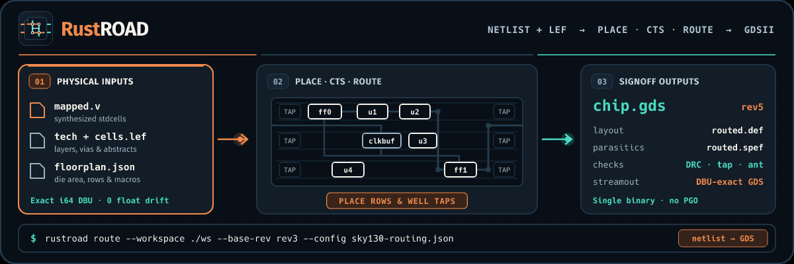

<p align="center">
  
</p>

<p align="center">
  <strong>Clean-room physical implementation in Rust: floorplan, electrostatic placement, CTS, routing, RC extraction, and DBU-exact GDSII.</strong><br>
  <a href="https://lab-emi.github.io/RustEDA/modules/rustroad/">Documentation</a> ·
  <a href="https://github.com/lab-emi/RustEDA">RustEDA Suite</a> ·
  <a href="https://lab-emi.github.io/RustEDA/benchmarks/">Benchmarks</a> ·
  <a href="docs/development-status.md">Development Status</a> ·
  <a href="LICENSE">Apache-2.0</a>
</p>

<picture>
  <source media="(prefers-reduced-motion: reduce)" srcset="docs/assets/rustroad-banner.svg">
  
</picture>

## Why RustROAD

RustROAD executes the entire physical back end — placement, legalization, well-tap insertion, clock-tree synthesis, global/detailed routing, antenna repair, RC extraction, and GDSII streamout — in **exact `i64` integer database units** with bit-exact reproducibility and up to **8× faster end-to-end physical closure** than OpenROAD/LibreLane across three open PDKs.

| Benchmark (paired quiet-host receipts) | RustROAD / RustEDA | LibreLane / OpenROAD | RustROAD delta |
| --- | ---: | ---: | --- |
| **Ibex + 2 SRAMs** (IHP SG13G2, to GDS) | **241.0 s** | 1,916.2 s | **7.95× faster**, 9/9 signoff PASS |
| **Ibex + 2 OpenRAMs** (SKY130A, single binary, non-PGO) | **499.6 s** (631 MiB RSS) | 1,771.8 s | **3.55× faster**, 0/0 DRC, 0 DRV, -35.3% power |
| **Ibex + 1 SRAM + fill** (GF180MCU D, to GDS) | **591.3 s** | 885.6 s | **1.50× faster**, -2.7% area, 1 vs 4 density |
| **Non-Ibex cores** (`picorv32`, `aes`, `sha256` on IHP) | **114–292 s** | 616–1,931 s | **5.4–8.4× faster**, 8/8 PASS, 3.6–4.8× less RAM |
| **Detailed + global routing** (Ibex SG13G2 in-flow) | **266.7 s** | 2,083.4 s | **7.8× faster**, -7.7% WL, -1.3% vias |
| **GDSII streamout** vs KLayout LEF/DEF | **0.50 s** | 1.38 s | **2.8× faster**, 2.0× less RAM |
| **RC extraction** vs OpenRCX (4T / 2T) | **2.62 s / 4.77 s** | 3.08 s / 3.14 s | **0.85× faster at 4T** (1.52× slower at 2T) |

Full receipts live in [Ibex Three-PDK](https://lab-emi.github.io/RustEDA/benchmarks/ibex-three-pdk/), [Tight-Clock Fmax](https://lab-emi.github.io/RustEDA/benchmarks/tight-clock-fmax/), and [Multi-Design Generalization](https://lab-emi.github.io/RustEDA/benchmarks/multi-design/).

## Core Capabilities

- **Integer DBU geometry (`i64`)**: Zero floating-point coordinate drift across floorplan, legalization, metal tracks, vias, and GDSII streamout; bit-exact repeated GDS across runs.
- **Spacing & pin-density-aware electrostatic placement**: Models legalizer cell spacing and optional pin-density spreading (`pin_density_sites_milli`) to eliminate local routing congestion without manual channels.
- **Single-session routing & bounded antenna repair**: Configurable scout expansion caps (`scouts.first_pass_expansions`), preserved prior-escape warm ECO rerouting, local via-offset/jumper repair, and multi-cut antenna weight checks.
- **Built-in RC extraction & native GDSII**: Parallel strip-based parasitic extraction emitting SPEF, plus direct DBU-exact DEF and GDSII writers.
- **Tri-PDK coverage**: Verified across `sky130_fd_sc_hd`, `gf180mcu_fd_sc_mcu7t5v0` / `9t5v0`, and `ihp-sg13g2` (`EZ130`), including hard SRAM macros.

## Quick Start

```sh
# Build release binary (or via superproject: ./dev build RustROAD --release --timeout 600)
cargo build --release --workspace

# Inspect available physical subcommands
target/release/rustroad --help

# Route a placed & CTS-buffered revision with explicit config
target/release/rustroad route \
  --workspace ./ws \
  --base-rev rev3 \
  --config path/to/routing.json
```

See [RTL-to-GDS Guide](docs/rtl2gds.md), [Architecture](docs/architecture.md), [Routing Convergence](docs/routing-convergence.md), and [Extraction](docs/extraction.md).

## Scope & Current Limits

- **Extraction at 2 threads & RSS**: Native RC extraction is narrowly faster than OpenRCX at 4 threads (`0.85×`, 30/30 runs) but remains `1.52×` slower at 2 threads with `1.31×` RSS and `+6.0%` total capacitance.
- **Post-placement setup sizing**: RustROAD performs electrical/hold ECOs and timing-aware routing, but does not yet run post-placement setup cell upsizing (a key factor on ultra-tight 20 ns IHP / 65 ns GF180 clocks).
- **Scale & signoff boundaries**: Full-SoC routing (e.g., PULPissimo / OpenC910), IR/EM, SI, and foundry tapeout signoff remain outside current qualification; see [Development Status](docs/development-status.md).

## License

Apache-2.0 — see [LICENSE](LICENSE).
