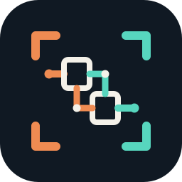

# RustEDA visual identity

All modules share the Signal Forge chip frame, copper/teal palette and 1200 × 400 three-card pipeline animation. Only the central symbol, product title and module workflow diagram change.

[Canonical brand guide](https://lab-emi.github.io/RustEDA/brand/) · [Artwork generator](https://github.com/lab-emi/RustEDA/blob/main/scripts/generate_brand.py)

Use the SVG fallback for reduced motion, provide alternative text, and keep benchmark claims in their evidence tables. The artwork is original and licensed under Apache-2.0.
