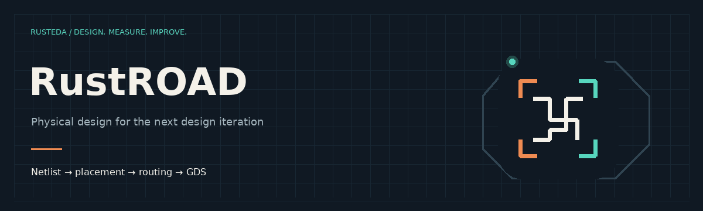

# RustROAD

RustROAD implements placement, clock trees, routing, extraction and GDS export. The recorded small-block baseline spans SKY130 HD and GF180 7T: **15 ordinary passes and one declared deviation**. OpenC910 physical implementation remains unverified.

[All RustEDA modules](https://lab-emi.github.io/RustEDA/)

<picture>
<source media="(prefers-reduced-motion: reduce)" srcset="assets/rustroad-banner.svg">

</picture>

- [Physical flow](rtl2gds.md)
- [Architecture](architecture.md)
- [Current qualification](closeout-2026-10-25.md)
- [PDK import](pdk-import.md)
- [Timing and extraction](postroute-timing.md)
- [Signoff scope](signoff.md)
