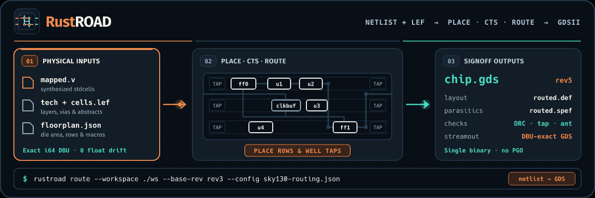

# RustROAD

Clean-room physical implementation in Rust: floorplan, electrostatic placement, legalization, CTS, global/detailed routing, antenna repair, RC extraction, and DBU-exact GDSII streamout.

[All RustEDA modules](https://lab-emi.github.io/RustEDA/) · [Benchmarks](https://lab-emi.github.io/RustEDA/benchmarks/) · [Development status](development-status.md)

<picture>
  <source media="(prefers-reduced-motion: reduce)" srcset="assets/rustroad-banner.svg">
  
</picture>

## Highlights

| Benchmark (paired quiet-host receipts) | RustROAD / RustEDA | LibreLane / OpenROAD | Delta |
| --- | ---: | ---: | --- |
| **Ibex + 2 SRAMs** (IHP SG13G2, to GDS) | **241.0 s** | 1,916.2 s | **7.95× faster**, 9/9 PASS |
| **Ibex + 2 OpenRAMs** (SKY130A, single binary) | **499.6 s** | 1,771.8 s | **3.55× faster**, 0/0 DRC, 0 DRV |
| **Ibex + 1 SRAM + fill** (GF180MCU D, to GDS) | **591.3 s** | 885.6 s | **1.50× faster**, -2.7% area |
| **Non-Ibex cores** (`picorv32`, `aes`, `sha256` IHP) | **114–292 s** | 616–1,931 s | **5.4–8.4× faster**, 8/8 PASS |
| **GDSII streamout** vs KLayout | **0.50 s** | 1.38 s | **2.8× faster**, 2.0× less RAM |
| **RC extraction** vs OpenRCX (4T / 2T) | **2.62 s / 4.77 s** | 3.08 s / 3.14 s | **0.85× at 4T** (1.52× slower at 2T) |

## Technical Guides

- **Flow**: [RTL-to-GDS](rtl2gds.md) · [Architecture](architecture.md) · [Flow steps](flow-steps.md) · [Signoff](signoff.md)
- **Engines**: [Electrostatic placement](electrostatic-placement.md) · [CTS & routing](cts-routing.md) · [Routing convergence](routing-convergence.md) · [Antenna repair](antenna-groups.md) · [RC extraction](extraction.md) · [GDS export](gds-export.md)
- **Verification**: [Qualification closeout](closeout-2026-10-25.md) · [MPW deviations](mpw-deviations.md) · [Memory budget](memory-budget.md)

## Known Limits

- Native extraction stays `1.52×` slower than OpenRCX at 2 threads (`1.31×` RSS at 4T, `+6.0%` total cap).
- Post-placement setup cell upsizing, IR/EM, SI, and full-SoC routing remain open work; see [Development status](development-status.md).
