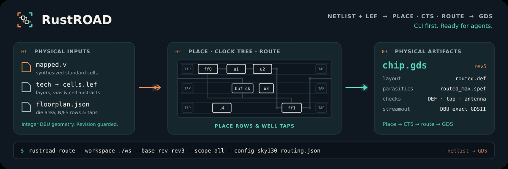

# RustROAD

RustROAD implements placement, clock trees, routing, extraction and GDS export. The recorded small-block baseline spans SKY130 HD and GF180 7T: **15 ordinary passes and one declared deviation**. OpenC910 physical implementation remains unverified.

[All RustEDA modules](https://lab-emi.github.io/RustEDA/)

<picture>
<source media="(prefers-reduced-motion: reduce)" srcset="assets/rustroad-banner.svg">

</picture>

- [Physical flow](rtl2gds.md)
- [Architecture](architecture.md)
- [Current qualification](closeout-2026-10-25.md)
- [PDK import](pdk-import.md)
- [Timing and extraction](postroute-timing.md)
- [Signoff scope](signoff.md)

## RustROAD vs OpenROAD at a glance

Ibex RTL-to-GDS on IHP SG13G2 with EZ130 cells and two SRAM macros, 2026-11-05: RustEDA and LibreLane 3.0.17 (OpenROAD, Yosys, KLayout, Magic, Netgen) ran one after the other on the same 4-vCPU host from the same prepared inputs, and the same signoff scripts checked both layouts.

- **Routing 8.5× faster than OpenROAD** (302.24 s against 2,570.19 s global and detailed), **placement and clock tree 1.7× faster**, and **export 168× faster** than LibreLane's streamout steps.
- **5.2 % less standard-cell area, 7.4 % less routed wire and 3.0 % fewer vias**, with 52 antenna diodes against 504 and **zero timing violations** against LibreLane's 112.
- GDS export **2.3× faster than KLayout** with **2.0× less peak memory**; foundry DRC, antenna and LVS run **1.3×, 1.3× and 1.4× faster** on RustROAD's layout (same scripts, same load).
- The whole RustEDA flow finishes **4.2× sooner end to end**. RustROAD's own extraction is level with OpenRCX at 4 threads and 1.69× slower at 2.

LibreLane's layout fails the shared timing gate (112 maximum-capacitance and fanout violations at TT and SS) and its equivalence check does not complete, so the receipt keeps its own ratio fields null under its publication rule; the multiples here divide the recorded times. Stages are paired by phase, not as identical tasks. RustEDA is not faster everywhere: its repair before global routing takes 1.18× LibreLane's two pre-route resizer steps alone, OpenRCX runs 1.36× longer on RustEDA's DEF, and the latch-up check 1.11× longer on its layout. [All stages, gates and losses](https://lab-emi.github.io/RustEDA/benchmarks/)

## PULPissimo benchmark scope

The [PULPissimo benchmark](https://lab-emi.github.io/RustEDA/benchmarks/pulpissimo/) is synthesis-only and does not time RustROAD. It compares the PULPissimo Ibex core with a bounded Yosys 0.70/ABC reference on SKY130 HD; no placement, clock tree, routing, extraction or GDS stage is part of it. On SKY130 the full PULPissimo SoC still exceeds a 2 h synthesis budget with behavioral L2 memory; an IHP SG13G2 / EZ130 synthesis-only test with 80 official SRAM macros completes in 426 s. Neither is a physical signoff result.

## Ibex host campaign · 2026-11-05

The RustEDA Ibex host campaign of 2026-11-05 (IHP SG13G2 / EZ130 with two real
SRAMs, on a 4-vCPU Intel Xeon cloud host with 15.7 GiB RAM and no swap; a
different and slower machine than on 2026-11-02) ran RustROAD CLI 0.5.0
(commit [`1921481`](https://github.com/lab-emi/RustROAD/commit/1921481c5f0fde21b62971a3a21e245065c9bf90)) in the repository's current native recipe under an 8 GiB
memory cap (+2 GiB memsw), and OpenROAD 26Q3 in LibreLane 3.0.17 Classic under
a 10 GiB cap, from the same prepared RTL, SDC and floorplan. The same
independent scripts checked both final layouts. **Both pass foundry main and
antenna DRC with 0 violations, latch-up tap coverage and full-device LVS; on
the shared timing gate the native layout has zero setup, hold, slew,
capacitance and fanout violations at TT and SS, while LibreLane's keeps 28 (TT)
and 24 (SS) capacitance and 30 fanout violations.** The native layout has less
standard-cell area, less routed wire and fewer vias, from a different netlist;
the receipt keeps its ratio fields null because LibreLane's layout fails a gate;
divided, the native layout has 5.2 % less area, 7.4 % less wire and 3.0 % fewer vias.

| Ibex final layout | RustROAD, native recipe | OpenROAD 26Q3, LibreLane Classic |
| --- | --- | --- |
| Standard-cell area | 187,585.2 µm² | 197,913.7 µm² |
| Routed signal wirelength | 897,357.3 µm | 969,571.6 µm |
| Vias | 118,525 | 122,194 |
| Standard cells / antenna diodes / taps / fillers | 14,058 / 52 / 5,934 / 34,322 | 15,191 / 504 / 6,900 / 44,672 |
| Foundry main / antenna DRC violations | 0 / 0 | 0 / 0 |
| Latch-up tap coverage (LU.a, LU.b) and full-device LVS | `passed`, `passed` | `passed`, `passed` |
| Slew / capacitance / fanout violations, TT and SS | 0 / 0 / 0 | 0 / 28 / 30 TT, 0 / 24 / 30 SS |
| Placement and CTS | 28.00 s | 19.69 s placement + 27.36 s CTS |
| Routing | 302.24 s at 4 threads, global and detailed | 83.34 s global routing and antenna checks/repair + 2,486.85 s detailed (4 threads) |
| Repair after routing | 7.34 s post-route + 18.99 s antenna repair and verification | None; its post-GRT repair runs before detailed routing |

RustROAD's GDS export took 0.831 s against 1.938 s for KLayout's LEF/DEF
streamout; its extraction took 6.260 s at 4 threads against 5.944 s for OpenRCX
(ranges overlap) and 10.121 s at 2 threads against 5.988 s. OpenRCX extraction
of the native DEF is slower than of LibreLane's (1.36× in same-load runs),
consistent with its route topology's larger number of wire pieces (192,328
against 129,901).

[Scope, tables and method](development-status.md#ibex-host-campaign-2026-11-05) ·
[Host campaign 2026-11-05](https://lab-emi.github.io/RustEDA/benchmarks/#ibex-host-campaign-2026-11-05)

## Ibex host campaign · 2026-11-02

In the RustEDA Ibex host campaign (IHP SG13G2 / EZ130 with two real SRAMs, on a
4-vCPU cloud host), RustROAD in the repository's published native recipe
(8 GiB memory cap) and OpenROAD 26Q3 in LibreLane 3.0.17 (10 GiB cap)
implemented the same prepared design. **Both final layouts pass foundry main
and antenna DRC with 0 violations and full-device LVS.** The native layout has
233,909.2 µm² standard-cell area, 1,679,076.6 µm routed signal wire and
301,099 vias, against 197,913.7 µm², 969,571.6 µm and 122,194 for OpenROAD,
on different netlists. Its
routing step took 389.63 s for global and detailed routing, followed by
588.35 s of post-route and antenna repair; OpenROAD's detailed routing alone
took 1,796.83 s. Each flow is a single timed sample and the netlists differ,
so no quotient is formed.

On the same final layout (medians of three runs), native extraction took
158.823 s with `RAYON_NUM_THREADS` at 2 or 4 (RustROAD's pool fixed at its
default of 2 threads), against 17.649 s and 17.114 s for OpenRCX at 2 and
4 threads; in the recipe's serial-query configuration it is effectively
single-threaded. GDS export took 3.019 s against 2.286 s for KLayout's LEF/DEF
streamout (timing only; the outputs are not byte-equivalent). The native run
is `unqualified` and stopped at the RustSTA/OpenSTA `timing_accuracy` gate;
neither flow passes every gate, so no end-to-end ratio is published. The
published recipe reproduces the run16-class layout; the R20/R21 recipe inputs
are not published. Deviations include the nixpkgs OpenROAD build, a
reconstructed EZ130 tech LEF and cell GDS, and LibreLane's own post-GRT
repair.

[Scope, tables and method](development-status.md) ·
[Place, CTS and route vs OpenROAD](https://lab-emi.github.io/RustEDA/benchmarks/#rustroad-place-cts-and-route-vs-openroad) ·
[Method and deviations](https://lab-emi.github.io/RustEDA/benchmarks/#host-campaign-method-and-deviations) ·
[All benchmarks](https://lab-emi.github.io/RustEDA/benchmarks/)

## Development update · 2026-11-01

The development source combines bounded extraction indices and query workers,
single-session antenna repair, an opt-in staggered tap lattice, placement-stage
diagnostics and spacing-aware electrostatic density. The density model accounts
for the same cell spacing required by legalization. Optional checkpoint retention
at an evaluation horizon reports the reason explicitly; in that update the default
policy stayed strict. Since then, keeping the checkpoint at the evaluation cap is
the default (`stop_at_evaluation_cap`, see
[electrostatic placement](electrostatic-placement.md)). Repeated same-path
routing near misses receive bounded repair.

[Source, evidence and remaining limits](development-status.md)
